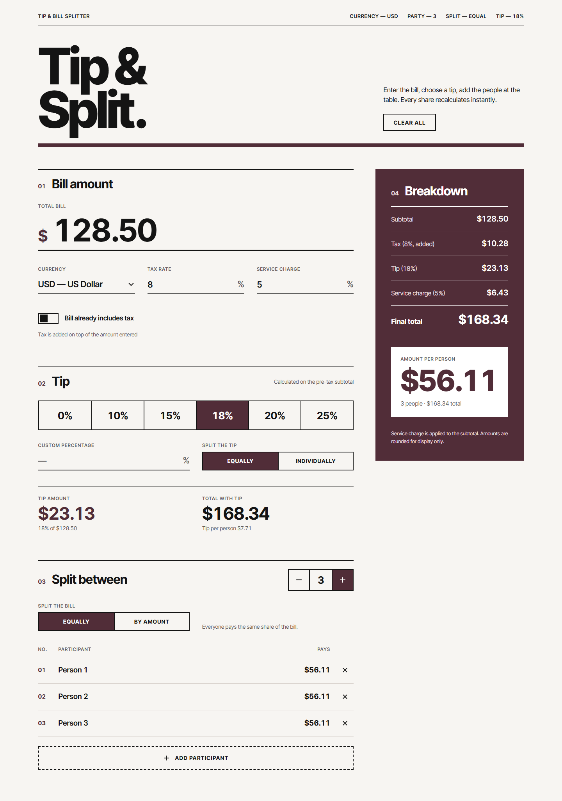
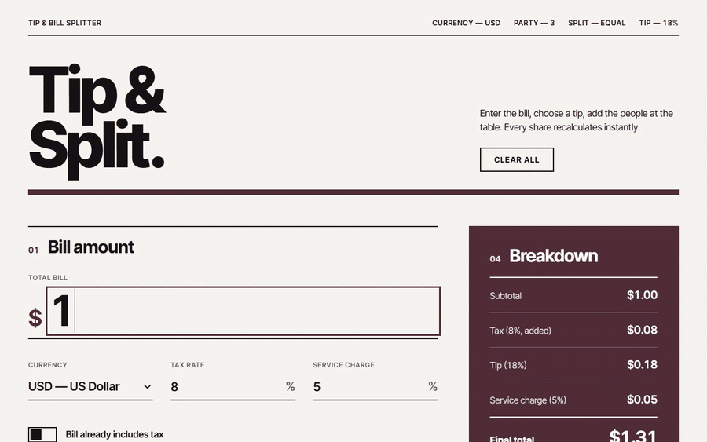

# Tip & Bill Splitter

Split a restaurant bill, with tax, service charge and tip, between everyone at the table. Every share updates as you type.

**Live demo:** [tipandbillsplit.vercel.app](https://tipandbillsplit.vercel.app/)



## Demo



[Watch the demo as MP4](docs/assets/demo.mp4)

## Features

- Enter the bill in any of 10 currencies (USD, EUR, GBP, PKR, INR, AED, CAD, AUD, CHF, JPY)
- Tax added on top, or taken out of a bill that already includes it
- Service charge on the subtotal
- Tip presets (0%, 10%, 15%, 18%, 20%, 25%) or a custom percent. Tip is worked out on the pre-tax subtotal.
- Split the bill equally, or by what each person owes
- Split the tip equally, or let each person pick their own percent
- Full breakdown and what each person pays
- Saves your last split in the browser. No account and no server.

## Setup

### Requirements

- [Node.js](https://nodejs.org/) 20.9 or newer
- npm (comes with Node.js)

### Install and run

```bash
git clone <repo-url>
cd tipandbilsplitter
npm install
npm run dev
```

Open [http://localhost:3000](http://localhost:3000).

### Scripts

| Command         | What it does                         |
|-----------------|--------------------------------------|
| `npm run dev`   | Start the dev server with hot reload |
| `npm run build` | Build for production                 |
| `npm start`     | Run the production build             |
| `npm test`      | Run the unit tests (Vitest)          |
| `npm run lint`  | Run ESLint                           |

## Project structure

```
app/                         Next.js App Router pages and global styles
components/tip-splitter/     The splitter UI
lib/split.ts                 All split maths (no UI), tested in lib/split.test.ts
docs/                        App roles, jobs to be done, user stories, README assets
transcripts/                 Prompts used to build the app
```

## Docs

- [App roles](docs/app-roles.md): who uses the app
- [Jobs to be done](docs/jobs-to-be-done.md): why they use it
- [User stories](docs/user-stories.md): how the app helps, with acceptance criteria

## Transcripts

The prompts used to build this app with Claude Code, in order:

- [Session 01](transcripts/session-01.md): building the app, the 0% tip, split by amount, the docs and this README

## Tech stack

Next.js 16, React 19, TypeScript, Tailwind CSS 4 and Vitest.

## Deploy

The app is deployed on [Vercel](https://vercel.com). To deploy your own copy, import the repository in Vercel. It needs no environment variables.
